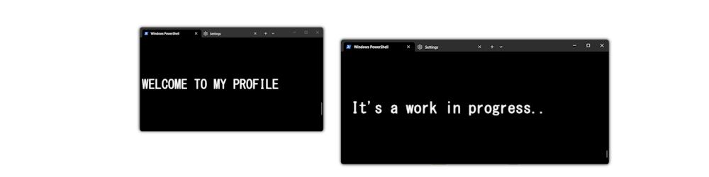

---

---

<!--
Header/hook (i.e. gif)
Links to other accounts (LinkedIn, personal site)
"About" - name, location, title, education, interests, technical background, currently learning, goals, hobbies
Tools & Tech Skills (use icons from DevIcon's website)
Awards/Certifications
GitHub History/Stats
-->
# one hashtag

## two hashtags

### oo you guessed it, three hashtags

#### four

##### five. latex? ${EX}_{TRA}~~\sum^{special}$

###### six, image test?

  
  
  
  
  
  

---

### line above y/n? anyways

## Technologies & Tools

### Infrastructure & Systems

### Programming & Development

  

My Homelab Hardware

- AMD EPYC 7763
- 64 cores / 128 threads
- Proxmox VE
- ECC Memory
- TrueNAS SCALE

--->
> [!NOTE]
> This aboutme is currently under active development.

thats cool
